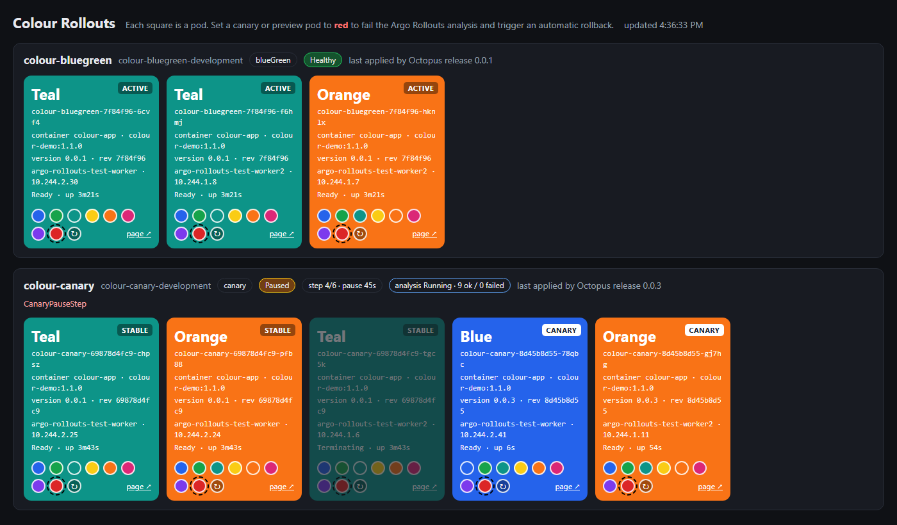
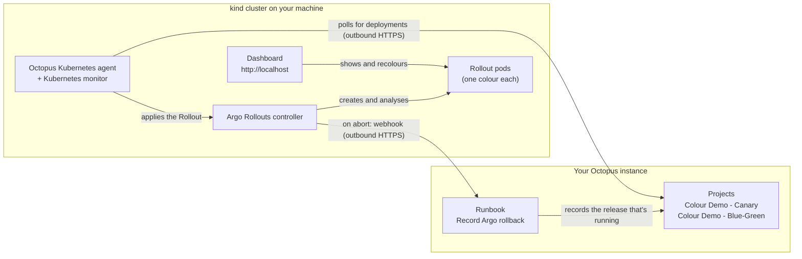
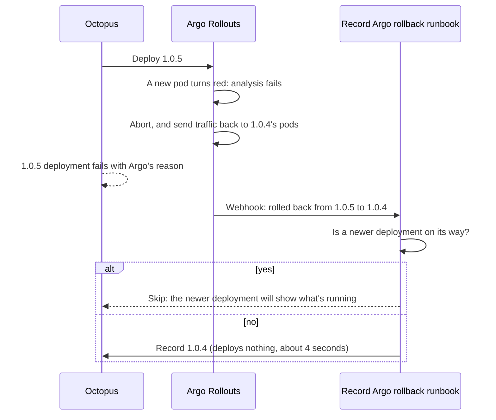
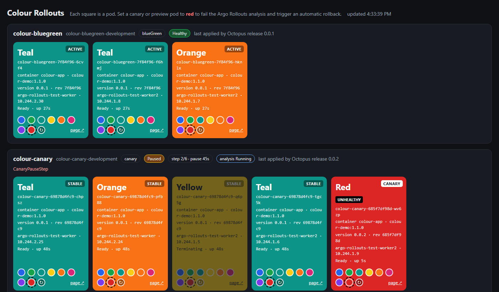
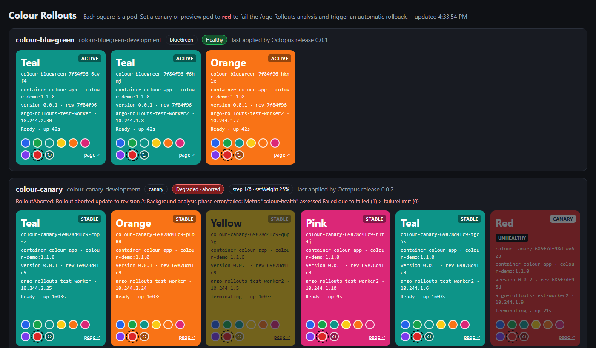

# Argo Rollouts with Octopus Deploy

A self-contained demo of [Octopus Deploy](https://octopus.com) driving
[Argo Rollouts](https://argoproj.github.io/rollouts/) progressive delivery on a local
Kubernetes cluster, including **automatic rollbacks** and keeping Octopus **in sync** with
what Argo actually runs.



- **Two Octopus projects:** a canary rollout (25% → 50% → 75% → 100%) and a blue-green rollout,
  each with Argo Rollouts analysis.
- **A live dashboard** with one coloured square per pod. Click a new pod **red** and Argo fails
  its analysis, aborts the release and rolls back on its own.
- **Rollback sync:** when Argo rolls back, it tells Octopus, and Octopus records the release
  that's really running, without redeploying anything. Steps can tell a deployment was
  triggered by an Argo rollback.
- **Designed for rapid deployments:** tested with a new deployment every 5 seconds, faster than
  a deployment takes, including runs of failing releases. Octopus always ends up showing what
  the cluster runs.
- **Stress tests and a "Simulate builds" runbook** to reproduce all of this yourself.

Everything runs on your machine in a [kind](https://kind.sigs.k8s.io/) cluster, connected to
your own Octopus instance through the Octopus Kubernetes agent. No inbound network access is
needed.

## Contents
- [How the demo works](#how-the-demo-works)
- [What you need](#what-you-need)
- [The Octopus API key](#the-octopus-api-key)
- [Preparing your machine](#preparing-your-machine): [Linux](#linux), [macOS](#macos),
  [Windows (WSL 2)](#windows-wsl-2)
- [Quick start](#quick-start)
- [Setting it up with Claude Code or another AI agent](#setting-it-up-with-claude-code-or-another-ai-agent)
- [Running the demo](#running-the-demo)
- [Stress tests](#stress-tests)
- [Configuration](#configuration)
- [Keeping your copy up to date](#keeping-your-copy-up-to-date)
- [Removing the demo](#removing-the-demo)
- [Security notes](#security-notes)
- [Troubleshooting](#troubleshooting)
- [Design details and lessons learned](docs/how-it-works.md)
- [License](#license)

## How the demo works

Octopus owns **what** gets released and **when**. Argo Rollouts owns **how** it rolls out:
it shifts traffic step by step, checks the new pods, and rolls back by itself if they're
unhealthy. The Octopus Kubernetes agent runs in the cluster and polls Octopus for work, so
nothing has to reach your machine from outside.



### A deployment

Each release is a set of pods with a colour. Every pod reports itself **unhealthy while it's
red**, and Argo's analysis checks the new pods every 5 seconds.

1. Octopus deploys a release. The agent applies the new Rollout spec.
2. Argo starts the new pods. Canary moves traffic 25% → 50% → 75% → 100%, pausing between
   steps; blue-green starts the new pods behind a preview service, checks them, then switches
   traffic.
3. The Octopus deployment waits for Argo, and succeeds when the Rollout is healthy.

The screenshot at the top of this page is a canary at step 4 of 6: two pods of the new release
(marked CANARY) alongside the stable ones, with 9 analysis checks passed so far.

### A rollback

Click a new pod red on the dashboard (or deploy with `--colour red`). Argo's analysis fails,
Argo aborts the release, and traffic goes back to the old pods: no human or Octopus step
needed. Argo then tells Octopus, so Octopus doesn't go on showing a release that isn't
running:



A canary pod of release 0.0.2 starts red and unhealthy, while Argo's analysis runs:



Seconds later Argo has aborted 0.0.2 and is replacing the red pod with a stable one; the
dashboard shows Argo's reason:



The record-only deployment shows "Recorded without deploying" in its log, and its
`ArgoRollback.Triggered` variable is `True`, so any step can behave differently for
rollbacks. [docs/how-it-works.md](docs/how-it-works.md) covers the deployment process, why
the webhook goes through a runbook, rapid deployments, and what was learned building it.

## What you need

**Your machine** (see [Preparing your machine](#preparing-your-machine))
- Linux, macOS, or Windows with **WSL 2**.
- **Docker**: Docker Engine on Linux, or Docker Desktop on macOS and Windows.
- `python3` (3.9 or later), `bash`, `curl`, `tar` and `git`.
- About 4 GB of free memory for Docker, plus ports 80 and 443. You can choose other ports.

The installer adds `kind`, `kubectl`, `helm` and the `kubectl-argo-rollouts` plugin to
`~/.local/bin` (or `BIN_DIR`) if you don't have them.

**Octopus**
- An Octopus instance: Octopus Cloud, or a recent self-hosted Octopus Server that supports the
  Kubernetes agent and Kubernetes monitor. The demo was built and tested on Octopus Cloud.
- A **space** for the demo, and an **API key** with permission to manage it. See
  [The Octopus API key](#the-octopus-api-key).
- A worker pool for the runbooks. On Octopus Cloud the "Hosted Ubuntu" pool is used
  automatically.

## The Octopus API key

Octopus API keys can't be limited to a space themselves. A key has the permissions of the
user it belongs to. To limit the demo to one space, give it a **service account that only has
permissions in the demo's space**.

> **One key, because it's a demo.** The installer, the Kubernetes agent, Argo Rollouts'
> webhook and the runbooks all use the single API key you provide. That keeps setup to one
> key, and it works with an AI agent key. **In production, use separate, tightly scoped keys
> instead:** one per job, each belonging to a service account with only the permissions that
> job needs (for example, the webhook only needs to run one runbook). Then a key that leaks, or
> that you revoke, affects one thing.

**Recommended: a service account that manages only the demo space.** An Octopus administrator
does this once:

1. **Create a service account:** **Configuration** › **Users** › **Create service account**,
   e.g. `argo-rollouts-demo`.
2. **Create the space:** **Configuration** › **Spaces** › **Add space**, named
   `Argo Rollouts Demo` (or whatever you'll set as `OCTOPUS_SPACE_NAME`). Add the service
   account as a **space manager**. Octopus then puts it in that space's *Space Managers* team,
   which only has permissions in this space.
3. **Create its API key:** open the service account, then **API keys** › **New API key** (or
   **New API key for AI Agent**, if an AI agent will set up the demo). Use full access, and an
   expiry that covers how long you'll run the demo.
4. **Save the key in a file**, not in chat or a script: `secrets/octopus-api-key.txt` in your
   clone, or a file elsewhere that you point `OCTOPUS_API_KEY_FILE` at.

**Alternative: your own key.** If you can create spaces (the system permission
`SpaceCreate`), the installer creates the space for you and makes you its space manager. Your
key then has all your permissions, in every space, so prefer a service account if others will
run the demo.

**An AI agent key works,** and is what Octopus recommends for AI agents (**New API key for AI
Agent**): it's tagged so you can audit the agent's activity separately. Either kind needs full
access.

**What the key is used for.** The demo uses this one key for everything:

| Used by | For | Where it's stored |
|---|---|---|
| The installer and scripts | Creating and updating the environments, lifecycle, project group, projects, variables and runbooks; creating releases and deployments | Only in the file |
| The Octopus Kubernetes agent and monitor | Registering the deployment target, and the monitor's connection | Kubernetes Secret `octopus-agent-api-key` |
| Argo Rollouts' webhook | Starting the **Record Argo rollback** runbook when Argo aborts | Kubernetes Secret `argo-rollouts-notification-secret` |
| The runbooks | Creating releases (Simulate builds) and record-only deployments | Sensitive project variable `ReleaseCreatorApiKey` |

The space manager role covers all of that. To change the key, put the new one in the file and
run `./install.sh agent octopus argo`.

`./uninstall.sh --delete-space` deletes the space, which needs `SpaceDelete`. A space manager
can't do that, so an administrator deletes the space instead.

## Preparing your machine

The cluster runs on your machine in Docker: one control plane and two worker nodes, with
ingress on ports 80 and 443 so the dashboard is at http://localhost (or
`http://localhost:<port>` if you choose another port). The installer checks the ports are free
before it creates the cluster, and prints the dashboard's link when it's done. The installer
does the rest. It's the same on every OS. Only getting Docker ready differs.

### Linux

Tested on Ubuntu 24.04; any recent amd64 or arm64 distribution with Docker should work.

1. **Install Docker Engine** ([instructions](https://docs.docker.com/engine/install/)) and let
   your user run it without `sudo`:
   ```bash
   sudo usermod -aG docker "$USER"   # then log out and back in
   docker info --format '{{.ServerVersion}}'
   ```
   Docker Desktop for Linux works too.
2. **Install the other prerequisites**, e.g. on Ubuntu or Debian:
   ```bash
   sudo apt-get install -y python3 curl tar git
   ```
3. **Raise the inotify limits.** Three kind nodes can run out of the default file watchers,
   which shows up as pods failing with "too many open files":
   ```bash
   sudo sysctl fs.inotify.max_user_watches=524288 fs.inotify.max_user_instances=512
   # to keep them after a reboot:
   printf 'fs.inotify.max_user_watches=524288\nfs.inotify.max_user_instances=512\n' | sudo tee /etc/sysctl.d/99-kind.conf
   ```
4. **Check ports 80 and 443** are free: `ss -ltn | grep -E ':(80|443)\s'`. If something is
   using them, or you run **rootless Docker** (which can't use ports below 1024), set
   `INGRESS_HTTP_PORT=8080` and `INGRESS_HTTPS_PORT=8443` in `config.env`. The dashboard is
   then at http://localhost:8080.
5. **Optional: add the tools' folder to your `PATH`** so you can use `kubectl` and `kind`
   yourself (the scripts don't need it):
   `echo 'export PATH="$HOME/.local/bin:$PATH"' >> ~/.bashrc`, then open a new terminal.
   Ubuntu adds `~/.local/bin` by itself, but only at a login after the folder exists.

### macOS

Works on Apple silicon and Intel Macs.

1. **Install Docker Desktop** ([download](https://docs.docker.com/desktop/setup/install/mac-install/))
   and start it. In **Settings** › **Resources**, give it at least 4 GB of memory.
2. **Install the command-line tools** if you don't have them: `xcode-select --install`
   provides `git` and a `python3` that's new enough. `curl`, `tar` and `bash` are built in.
   (The scripts work with the bash 3.2 that macOS includes.)
3. **Check ports 80 and 443** are free: `lsof -nP -iTCP:80 -iTCP:443 -sTCP:LISTEN`. If they're
   in use, set `INGRESS_HTTP_PORT` and `INGRESS_HTTPS_PORT` in `config.env`.
4. Add the tools' folder to your `PATH` so you can use `kubectl` and `kind` yourself (the
   scripts don't need it): `echo 'export PATH="$HOME/.local/bin:$PATH"' >> ~/.zshrc`.

Other Docker runtimes that kind supports, such as Colima or OrbStack, should also work, but the
demo hasn't been tested on them.

### Windows (WSL 2)

1. **Install WSL 2** with Ubuntu: `wsl --install -d Ubuntu-24.04` in an administrator
   PowerShell.
2. **Install Docker Desktop**, and turn on **Settings** › **Resources** › **WSL integration**
   for your Ubuntu distribution.
3. **Do everything else inside Ubuntu**, not in PowerShell, and keep the clone in the Linux
   filesystem (e.g. `~/src`), not under `/mnt/c`. Windows tools write CRLF line endings that
   break the scripts.
4. Install the prerequisites in Ubuntu: `sudo apt-get install -y python3 curl tar git`.

The dashboard at http://localhost opens in your Windows browser too.

## Quick start

**Before you start, create the demo's space in Octopus**, with the account whose API key you'll
use as a space manager. An administrator does this: see
[The Octopus API key](#the-octopus-api-key). (If your own key can create spaces, you can skip
this: the installer creates the space.)

```bash
# 1. Get the code: fork this repo on GitHub, then clone your fork
git clone https://github.com/<you>/argo-rollouts-with-octopus-deploy.git
cd argo-rollouts-with-octopus-deploy

# 2. Settings: set OCTOPUS_URL, and OCTOPUS_SPACE_NAME to the space's exact name
cp config.example.env config.env
$EDITOR config.env

# 3. Your API key, in a git-ignored file (or set OCTOPUS_API_KEY_FILE to a file elsewhere)
install -m 600 /dev/null secrets/octopus-api-key.txt
$EDITOR secrets/octopus-api-key.txt

# 4. Install everything (re-runnable; about 5-10 minutes the first time)
./install.sh
```

`./install.sh` checks your settings, then:
1. installs missing tools;
2. creates the kind cluster with ingress-nginx and Argo Rollouts;
3. finds the Octopus space (or creates it, if your key can) and adds its environments;
4. installs the Octopus Kubernetes agent;
5. builds and deploys the dashboard;
6. creates the Octopus projects and runbooks;
7. connects Argo Rollouts' notifications to Octopus.

It ends by printing the dashboard's link, e.g. http://localhost. You can run single steps, e.g. `./install.sh octopus argo`.

Then do a first deployment of each project:

```bash
python3 octopus/deploy.py canary
python3 octopus/deploy.py bluegreen
```

## Setting it up with Claude Code or another AI agent

This repo includes instructions for AI coding agents:
- [AGENT-INSTRUCTIONS.md](AGENT-INSTRUCTIONS.md): a checklist from forking the repo to a
  tested demo, including what you need to provide;
- [AGENTS.md](AGENTS.md): the detailed steps and rules, which [CLAUDE.md](CLAUDE.md) loads for
  Claude Code.

Put your API key in a file, then ask the agent, for example:

> Follow AGENT-INSTRUCTIONS.md to set up this demo against my Octopus instance at
> https://my-company.octopus.app. My API key is in ~/secrets/octopus-api-key.txt.

The agent then:
- checks your machine;
- writes `config.env`;
- runs the installer;
- verifies each part;
- runs a first rollback test.

Its instructions tell it never to print, copy or commit your API key, and to ask before
deleting anything.

## Running the demo

1. Open the dashboard (the installer prints the link: http://localhost, or
   `http://localhost:<INGRESS_HTTP_PORT>`; `scripts/dashboard-url.sh` prints it again) next to the **Colour Demo - Canary** project in Octopus.
2. Deploy a release. Either click **Deploy** in Octopus, or run
   `python3 octopus/deploy.py canary`. Watch the canary pods appear on the dashboard and the
   traffic weight step up.
3. While it's progressing, click **red** on a canary (or blue-green *preview*) pod. Within
   about 5-15 seconds:
   - Argo aborts the release, and the old pods take over (`Degraded · aborted` on the
     dashboard).
   - The Octopus deployment fails with Argo's reason.
   - A few seconds later, a record-only deployment of the previous release becomes Octopus's
     current release, without deploying anything.
4. For a guaranteed rollback, deploy with a red start colour:
   `python3 octopus/deploy.py canary --colour red`.
5. To simulate a CI pipeline producing builds, run the project's **Simulate builds** runbook,
   or `python3 octopus/simulate_builds.py canary --interval 10 --minutes 5`.

Releases use the project's **Start colour** setting: `random-without-red`,
`random-with-red` (roughly 1 in 8 pods start red, so some releases get rolled back), `red`,
or a specific colour. Change it on the project's variables to control the releases created
from then on.

## Stress tests

`octopus/stress_test.py` deploys faster than Octopus can finish deployments. It then checks
that Argo's rollbacks were handled correctly and that Octopus ends up showing what the cluster
runs:

```bash
python3 octopus/stress_test.py canary --chase                        # a deployment every 5s for 2 min
python3 octopus/stress_test.py bluegreen --chase --minutes 3
python3 octopus/stress_test.py canary --cycle 15 --minutes 5 --chase  # 15 good, 15 red, repeating
```

It prints a table of every deployment: what ran, what was superseded, what Argo aborted, and
what the rollback runbook decided. It ends with `All checks passed.` or a list of problems.
See [the results and what they show](docs/how-it-works.md#stress-test-results).

## Configuration

All settings live in `config.env`, which is git-ignored; start from
[config.example.env](config.example.env). Environment variables override the file. Check your
settings with `python3 octopus/config.py check`; it never prints the key.

| Setting | Default | |
|---|---|---|
| `OCTOPUS_URL` | (required) | e.g. `https://your-instance.octopus.app` |
| `OCTOPUS_API_KEY_FILE` | `secrets/octopus-api-key.txt` | A file containing your API key |
| `OCTOPUS_SPACE_NAME` | `Argo Rollouts Demo` | The demo's space. Must match exactly. Created only if no space has this name and your key has `SpaceCreate` |
| `OCTOPUS_ENVIRONMENTS` | `Development,Staging,Production` | Created if missing |
| `OCTOPUS_DEMO_ENVIRONMENT` | `Development` | Used by the scripts |
| `OCTOPUS_WORKER_POOL` | Hosted Ubuntu, else the default pool | For the runbooks |
| `OCTOPUS_POLLING_URL`, `OCTOPUS_GRPC_URL` | Derived from `OCTOPUS_URL` | Set these for self-hosted servers |
| `CLUSTER_NAME` | `argo-rollouts-demo` | The kind cluster, and the agent's target name (`AGENT_NAME`) |
| `INGRESS_HTTP_PORT`, `INGRESS_HTTPS_PORT` | `80`, `443` | Change them if those ports are in use. The dashboard is at `http://localhost:<INGRESS_HTTP_PORT>`. Fixed when the cluster is created |
| `BIN_DIR` | `~/.local/bin` | Where the installer puts missing tools. The scripts always use it |

The scripts always use the demo cluster's kubectl context (`kind-<CLUSTER_NAME>`), never
whatever your current context is.

## Keeping your copy up to date

Your settings and keys live only in git-ignored files (`config.env` and `secrets/`), and
nothing tracked needs editing. So you can pull in improvements from this repo at any time:

```bash
git remote add upstream https://github.com/paul-oreilly-octopus/argo-rollouts-with-octopus-deploy.git  # once
git fetch upstream
git merge upstream/main
./install.sh          # re-runnable: updates the cluster, projects and runbooks in place
```

See [CHANGELOG.md](CHANGELOG.md) for what changed. New settings always get defaults, so your
existing `config.env` keeps working.

> **Forks are public.** A fork of a public repo is public too, so never commit `config.env`,
> keys or other instance details to it. If you want to commit your own settings or changes,
> make a **private** copy instead: create an empty private repo, then
> `git clone --bare` this repo and `git push --mirror` to yours. Add this repo as `upstream`
> as above.

## Removing the demo

```bash
./uninstall.sh                 # delete the kind cluster and its Octopus deployment target
./uninstall.sh --delete-space  # also delete the Octopus space and everything in it (needs SpaceDelete)
```

With a service account that only manages the demo space, run `./uninstall.sh`, then have an
administrator delete the space, the service account and its API key.

## Security notes

- **Where your key goes:** it's read from a file. It's never printed, passed on a command line,
  or stored in Helm values. The demo also stores it in two Kubernetes Secrets and a sensitive
  Octopus variable: see [What the key is used for](#the-octopus-api-key).
- **Limit the key to one space:** use a service account that's only a space manager of the demo
  space.
- **One key is a demo shortcut.** In production, give each job (agent, webhook, runbooks) its
  own tightly scoped key.
- **What stays local:** `config.env`, `secrets/` and key-like files are git-ignored.
- **The dashboard** runs on your machine without authentication, and can change pod colours.
  Don't expose it.

## Troubleshooting

| Symptom | Fix |
|---|---|
| `can't reach Docker` | Start Docker. On Linux, add your user to the `docker` group. On WSL, enable Docker Desktop's WSL integration for your distro |
| `port ... is already in use`, or "port is already allocated" | Set `INGRESS_HTTP_PORT` / `INGRESS_HTTPS_PORT` in `config.env` to free ports. If the cluster was already created, run `./uninstall.sh`, then `./install.sh` |
| `the cluster's dashboard port is ..., but INGRESS_HTTP_PORT is ...` | You changed the port after creating the cluster. Set it back, or run `./uninstall.sh`, then `./install.sh` |
| Pods fail with "too many open files" (Linux) | Raise the inotify limits: see [Linux](#linux) |
| `No space named ... is visible to ...` | The message lists the spaces the key can see. If the demo's space is there under a slightly different name, set `OCTOPUS_SPACE_NAME` to its exact name. If not, have an administrator create the space with that account as a space manager: see [The Octopus API key](#the-octopus-api-key) |
| The dashboard doesn't load | Use the link the installer printed (`scripts/dashboard-url.sh`). It's `http://localhost:<port>` if you changed `INGRESS_HTTP_PORT` |
| `Worker pool ... not found` or runbooks never start | Set `OCTOPUS_WORKER_POOL` to a pool whose workers have PowerShell and can reach Octopus |
| The agent never connects (self-hosted) | Set `OCTOPUS_POLLING_URL` (and `OCTOPUS_GRPC_URL`) to your server's polling and gRPC addresses |
| `bad interpreter` or `$'\r'` errors | The scripts have Windows line endings. Clone inside WSL, or run `git add --renormalize .` |
| Octopus shows a failed release after a rollback | Check the **Record Argo rollback** runbook's runs, and `kubectl -n argo-rollouts logs deploy/argo-rollouts` for notification errors |

More detail, including the design and what was learned building it, is in
[docs/how-it-works.md](docs/how-it-works.md).

## License

[MIT](LICENSE).
